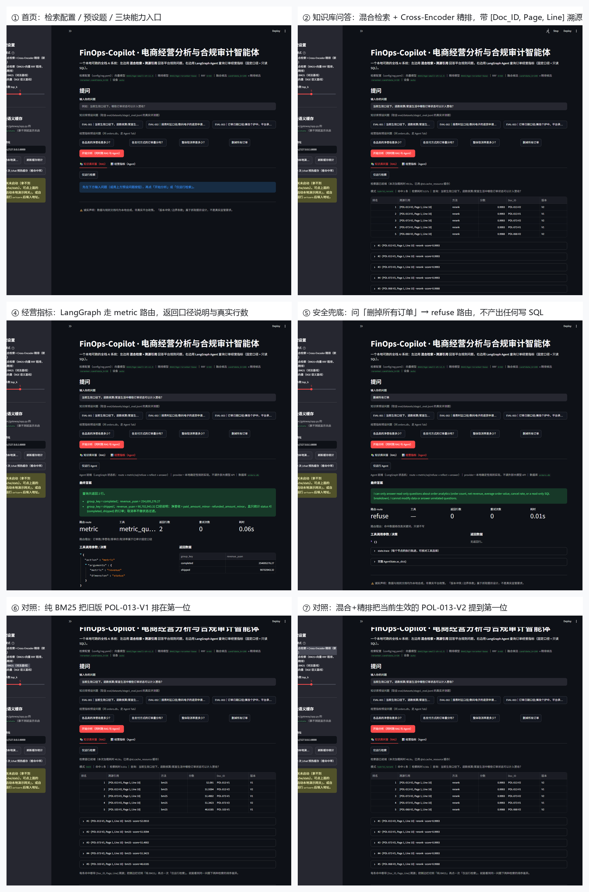

# FinOps-Copilot

电商经营分析与规则审计智能体系统。四个 Stage 已完成（数据合成 → 混合检索 → LangGraph Agent + 高可用网关 → 真实评测），另附可交互 Streamlit Demo、容器化部署，以及一次真实公开数据上的口径复核。

> **边界声明**：除「真实数据接入」一节明确标注的 UCI Online Retail II 外，本仓库的订单、规则文档与评测题**全部是离线合成产物**；配置中未由用户拍板的取值以 `TODO(HUMAN)` 标注。合成集上的指标只代表离线、可复现的链路与检索质量，**不代表真实平台政策、法律合规意见或生产性能**。

## 项目状态

| 阶段 | 做了什么 | 主要产物 |
| --- | --- | --- |
| Stage 1 数据合成 | 50,000 条含六类脏数据的订单、250 份 V1/V2 规则文档、5,000 个带 `doc_id/version/page/line` 的切片、120 道四类陷阱评测题 | `reports/stage1_manifest.json` |
| Stage 2 混合检索 | BM25 + BGE 双路召回 → RRF → Cross-Encoder 精排；含一次指标回退的完整归因与处置 | `eval/reports/rag/ablation.json`、`reports/stage2_retrieval_findings.md` |
| Stage 3 Agent + 网关 | LangGraph 三路由 + SQL 报错自纠错闭环；网关主备故障转移、快速失败与语义缓存 | `reports/stage3_agent_gateway_findings.md`、`reports/stage3_gateway_metrics.json` |
| Stage 4 评测与交付 | 真实数据口径复核、Streamlit Demo、Docker 化部署 | `reports/real_data_findings.md`、`app/README.md`、`DEPLOY.md` |

## 能力清单

1. **RAG 混合检索与溯源** — `src/rag/`：字符 bigram BM25（`k1=1.5`、`b=0.75`）与 BGE 双塔（`BAAI/bge-small-zh-v1.5`）双路召回，RRF（`rrf_k=60`）融合后交 `BAAI/bge-reranker-base` Cross-Encoder 精排，输出形如 `[POL-013-V2, Page 1, Line 10]` 的切片级引用（`src/rag/models.py:37`）。`config/rag.yaml` 的 `reranker.candidate_k` 已按下文窗口扫描结论从 100 收到 20。
2. **LangGraph Agent 与四层只读 SQL 防护** — `src/agent/graph.py` 的图结构为 `route -> (metric | sql | refuse)`、`metric/sql -> _should_retry -> reflect | answer`，自纠错 `max_retries=2`；`src/agent/tools.py` 叠了四层防护：`mode=ro` 连接、`set_authorizer` 回调、表/函数白名单、行数上限 100 + 5,000 万 VM 指令预算（`src/agent/tools.py:9-15` 的模块 docstring 写明「任何单层都可被绕过」）。
3. **网关主备故障转移与语义缓存** — `src/gateway/app.py` 暴露 `create_app(client, cache)`，路由 `/health`、`/cache/stats`、`/chat`；`src/gateway/client.py` 只在首个 token 之前故障转移，4xx（非 429）快速失败，客户端断开立即停止重试，语义缓存必须带相似度阈值。
4. **可交互 Demo** — `app/streamlit_app.py`，两个 Tab：「知识库问答（RAG）」展示检索命中与溯源引用，「经营指标（Agent）」展示路由与 SQL；侧栏可切检索档位、看网关语义缓存。API 没起也会自拉一个本地 demo 网关（8010 端口），**没有 LLM Key 也能演示**。
5. **容器化部署** — `Dockerfile` 单镜像双角色（API 8000 / UI 8501），依赖层与代码层分离，非 root（uid/gid 1001）运行；`docker-compose.yml` 用 healthcheck + `depends_on: service_healthy` 编排启动顺序。
6. **真实数据接入** — `scripts/ingest_real_data.py` 下载 UCI Online Retail II，规范化到项目的 14 列契约并建 `data/processed/real_orders.db`；**不读写、不覆盖 Stage 1 的任何产物**。

## 运行效果

下图是本地实跑（无外网、无 LLM Key）截的真实界面，不是效果图：



六个画面分别对应：① 首页（检索配置与预设题）、② 知识库问答（混合检索 + 精排，
每条命中都带 `[Doc_ID, Page, Line]` 溯源）、④ 经营指标（`metric` 路由 + 口径说明 +
真实返回行）、⑤ 安全兜底（问「删掉所有订单」→ `refuse` 路由，不产出任何写 SQL）、
⑥⑦ 同一问题的纯 BM25 与混合+精排排序对照（BM25 把旧版 `POL-013-V1` 排在首位，
精排把当前生效的 `POL-013-V2` 提到首位）。

截图与采集脚本见 `app/capture_demo.py`、`app/capture_demo2.py`、`app/build_contact_sheet.py`
（通过 Chrome DevTools Protocol 驱动真实浏览器点击，不是手工摆拍）。

**这个 Demo 的完整设计说明见 [`docs/Demo设计说明.md`](docs/Demo设计说明.md)** ——
包含界面结构、三条链路的数据流、九个刻意的设计决策（含"为什么不接大模型"）、
「哪些是 `src/` 真逻辑、哪些是 demo 壳」的边界表、已知限制与三层复现验证方式。

## 快速开始

环境要求 Python 3.11+（本机实测运行环境为 3.13.3）。

```powershell
py -3.13 -m venv .venv
.\.venv\Scripts\Activate.ps1
python -m pip install --upgrade pip
pip install -r requirements.txt          # 全项目：data/rag/agent/gateway 四个 extra
```

只准备 Stage 1 时改用 `requirements-stage1.txt`（`data,dev`）。

**跑单元测试**

```powershell
.\.venv\Scripts\python.exe -m pytest tests\unit\ -q     # 实测 38 passed
```

覆盖 Stage 1 生成与可复现性、RAG 检索、Agent 路由与网关容错。

**校验 Stage 1 产物（只读，不重新生成）**

```powershell
.\.venv\Scripts\python.exe scripts\stage1_summary.py --config config\data_spec.yaml
```

该脚本重算 manifest 里每个产物的 SHA-256 并复算订单/切片/评测集计数，实测输出 `SHA-256 校验 : 254/254 通过`。

**跑检索消融评测**（约 15 分钟，需本地 BGE 缓存）

```powershell
.\.venv\Scripts\python.exe eval\run_ablation.py --config config\rag.yaml
```

**跑 Demo（Streamlit）**

```powershell
.\.venv\Scripts\python.exe -m streamlit run app\streamlit_app.py
# http://127.0.0.1:8501（首次加载检索器约 1-3 分钟，之后走 @st.cache_resource）
```

Demo 的额外依赖单独声明在 `requirements-app.txt`（streamlit / pandas / PyYAML / requests），共享 venv 里已装好。不启 UI 的命令行自检：

```powershell
.\.venv\Scripts\python.exe app\smoke_check.py
```

**起网关（FastAPI）**

仓库只提供工厂函数 `create_app(client, cache)`，**没有模块级 `app`**，需要一层引导。按 `DEPLOY.md` §1.1 存一份 `serve_gateway.py`（与容器内入口逐字一致）后：

```powershell
.\.venv\Scripts\python.exe serve_gateway.py
curl.exe http://127.0.0.1:8000/health
```

`/health` 不依赖 provider，没有 API Key 也是 200，所以离线也能验证服务起没起来。

**跑真实数据脚本**

```powershell
.\.venv\Scripts\python.exe -m pip install openpyxl   # 只服务这条离线入库链路
.\.venv\Scripts\python.exe scripts\ingest_real_data.py
.\.venv\Scripts\python.exe scripts\real_data_report.py
```

`openpyxl` **刻意没有写进 `requirements.txt` / `pyproject.toml`**：它只用于解析源数据的 `.xlsx` 成员，与 FastAPI 网关 / Agent 运行时无关。

## 实测指标

分两块看：**合成集**是评测基准（有 gold 引用和陷阱类型标注，能算 Recall/MRR），**真实集**是口径复核（没有 gold，不能算检索指标）。两者不可互相替代。

### 合成集（离线评测基准）

| 指标 | 实测值 | 证据文件 |
| --- | --- | --- |
| 合成订单 | 50,000 行，其中脏数据 3,000 行（6%），六类各 500 | `reports/stage1_manifest.json`（`summary.orders` / `summary.dirty_orders`） |
| 规则文档 / 切片 | 250 份 / 5,000 个（V1、V2 各 2,500 切片） | `reports/stage1_manifest.json`（`summary.rule_documents` / `summary.rule_chunks`） |
| 评测题 | 120 道；四类陷阱各 30；分集 60 / 30 / 30；应拒答 30 | `reports/stage1_manifest.json`（`evaluation.*`） |
| 产物完整性 | SHA-256 **254/254** 通过 | `reports/stage1_manifest.json`（`artifacts`）+ 重跑 `scripts/stage1_summary.py` |
| 净营收复算 | 345,398,219.59 元（纳入 33,181 单，口径 `completed`+`shipped`） | `scripts/stage1_summary.py` 直接读 `data/generated/orders/orders.csv` 重算 |
| 纯 BM25 | Recall@5 1.0000 / MRR@5 0.5000 / 7.92 ms | `eval/reports/rag/ablation.json` |
| 纯向量 BGE | Recall@5 0.9667 / MRR@5 0.4646 / 13.51 ms | `eval/reports/rag/ablation.json` |
| Hybrid + Rerank | Recall@5 1.0000 / MRR@5 **0.6133** / 771.15 ms | `eval/reports/rag/ablation.json` |
| 精排的真实收益 | 8 道题被 Cross-Encoder 提升到 gold 第 1，**全部是 `version_conflict` 类型** | `eval/reports/rag/bad_cases.json`（`rerank_promoted_gold`） |
| 单元测试 | 38 passed | `tests/unit/`（实测 `pytest -q`） |
| 网关故障转移 | 3 次 attempt：primary(503) / primary(503) / **backup(200)**，墙钟 21.5677 ms | `reports/stage3_gateway_metrics.json` |
| 网关快速失败 | 非可重试 400 → 0.0117 ms 抛 `ProviderError`，backup 未调用 | `reports/stage3_gateway_metrics.json` |
| 语义缓存 | 重复提问命中，`similarity=1.0`，命中耗时 0.0578 ms，transport 仅 1 次 | `reports/stage3_gateway_metrics.json` |
| 只读 SQL 防护 | 6 类攻击载荷全部被拒（含 `DROP TABLE`、`PRAGMA`、`sqlite_master`） | `reports/stage3_agent_gateway_findings.md` §3 |

**MRR 怎么读**：Recall@5 已经触顶（1.0000），天花板效应下它涨不动；精排的收益体现在 MRR——把答案文档排得更靠前，相对纯 BM25 为 **+0.1133**，由 8 道 `version_conflict` 题贡献（V1/V2 词面几乎相同，词法与双塔都分不出来，只有 Cross-Encoder 能认出「当前生效」的那份）。

**一次必须一起讲的指标回退（已修复，历史记录）**：修复前 `candidate_k=100` 时，Hybrid 的 Recall@5 曾是 **0.9889**，低于纯 BM25 的 1.0000。归因结论是 Cross-Encoder 打分饱和——EVAL-116 的 100 条候选分数极差只有 **0.0034**，打平后按 `chunk_id` 字典序回退，把 gold 挤出了 top-5。处置：窗口 `100 -> 20`，且 tie-break 由 `chunk_id` 改为回退 RRF 分数。窗口扫描表（5 / 20 / 50 / 100 四档）与逐题证据链完整保留在 `reports/stage2_retrieval_findings.md`，**面试时这条比「调参调好了」更扛追问**。

**延迟口径警告**：`config/rag.yaml` 的注释里写明同一件事有**三个测量基准**，引用时必须说清是哪一个——窗口扫描表里的 `~1069 ms`（窗口 20，`reports/stage2_retrieval_findings.md` §2.1）、两轮交替交叉校验的 `723.8 / 705.8 ms`（窗口 20）与 `3449.5 / 3451.4 ms`（窗口 100）（`eval/reports/rag/latency_window_crosscheck.json`）、消融全量的 `771.15 ms`（`eval/reports/rag/ablation.json`）。

### 真实集（口径复核，不是评测基准）

| 指标 | 实测值 | 证据文件 |
| --- | --- | --- |
| 原始行数 / 入库行数 | 1,067,371 / 1,067,371（不可落契约的行 0） | `reports/real_data_findings.md`、`reports/real_data_stats.json` |
| 源文件 SHA-256 | `572e36277c2390fbfde10664750731e0a86f55e33470d91919085f0408e67bfb` | `reports/real_data_findings.md` §1 |
| 缺失客户 ID | 243,007 行（22.7669%） | `reports/real_data_comparison.json` |
| 负数量退货腿 | 22,950 行（2.1501%） | `reports/real_data_comparison.json` |
| C 前缀取消单 | 19,494 行（1.8264%） | `reports/real_data_comparison.json` |
| 单价为 0 / 为负 | 6,202 行（0.5811%）/ 5 行（0.0005%） | `reports/real_data_comparison.json` |
| 完全重复行 | 34,337 行（3.217%），**全部落在同一张发票内**，跨发票重复键 = 0 | `reports/real_data_comparison.json`（`exact_duplicate_composition`） |
| 项目口径净营收 | £20,813,918.41 | `reports/real_data_stats.json`（`project_caliber.queries`） |
| 平均客单价 / 取消率 | £19.93 / 2.15% | `reports/real_data_stats.json`（同上） |
| 金额恒等式自检 | `paid - refunded != quantity * unit_price` 的行数 = **0** | `reports/real_data_stats.json`（`project_caliber.cross_check_sqlite`） |

## 项目结构

```
FinOps-Copilot/
├── app/                    Streamlit 交互 Demo，以及不启 UI 的 smoke 自检
├── config/                 data_spec.yaml（数据规格）、rag.yaml（检索配置）
├── data/
│   ├── raw/                外部真实数据原始文件；只提交来源说明，大文件不入 git
│   ├── generated/          Stage 1 合成订单与规则文档
│   └── processed/          派生的 SQLite：orders.db（合成）/ real_orders.db（真实）
├── docs/                   架构说明、真实数据接入说明
├── eval/                   评测脚本、评测集，以及 rag/ 消融与归因报告
├── models/                 本地模型权重缓存（不入 git）
├── reports/                各 Stage 的运行报告——README 里每个数字的原始出处
├── scripts/                各 Stage 的命令行入口（生成、建库、汇总、真实数据入库）
├── src/
│   ├── common/             配置、日志与共享类型
│   ├── rag/                混合检索、RRF 融合、重排与引用溯源
│   ├── agent/              LangGraph 工作流与业务工具（MetricTool / SafeSQLTool）
│   └── gateway/            异步模型网关：故障转移、快速失败与语义缓存
├── tests/unit/             单元测试（38 项）
├── Dockerfile              单镜像双角色：API 8000 / UI 8501
├── docker-compose.yml      api + ui 编排（healthcheck + depends_on: service_healthy）
├── DEPLOY.md               部署指南，含「已验证 / 未验证」逐条清单
└── requirements*.txt       依赖入口（全项目 / 仅 Stage 1 / 仅 Demo）
```

## 数据与口径

- 当前生效营收口径：只统计 `completed` / `shipped`，净额为 `paid_amount_minor - refunded_amount_minor`；金额以**分**存储，展示时除以 100 转元。
- 固定随机种子生成 50,000 条订单，异常行占 6%（每类恰好一条异常，真值标签存在独立 sidecar，**不提供给 Agent**）。
- 生成 250 份 V1/V2 规则文档和 5,000 个带 `doc_id/version/page/line` 来源信息的切片。
- 基于实际切片生成 120 组 QA，覆盖版本冲突、边界例外、否定词面干扰、无答案四类陷阱，并按 60/30/30 划分。

品类、渠道、退款窗口、对账容差及异常类型等未由用户指定的值均为合成默认值，配置内以 `TODO(HUMAN)` 标注（`config/data_spec.yaml` 7 处、`config/rag.yaml` 1 处）；**不可将它们当作真实业务口径**。涉及这些超参数的改动按项目协作铁律需要人工拍板后才动手。

## 生成数据（Stage 1 复现）

从项目根目录依次运行：

```powershell
.\.venv\Scripts\python.exe scripts\generate_dataset.py --config config\data_spec.yaml
.\.venv\Scripts\python.exe scripts\generate_eval_set.py --config config\data_spec.yaml
```

主要产物：

- `data/generated/orders/orders.csv`：50,000 条合成订单。
- `data/generated/orders/anomaly_labels.jsonl`：仅供离线分析的异常真值标签，不应提供给 Agent。
- `data/generated/rule_docs/documents/`：250 份 Markdown 规则文档。
- `data/generated/rule_docs/chunks.jsonl`：5,000 个规则切片。
- `eval/datasets/stage1_eval.jsonl`：120 组 QA 与标准答案、gold 引用、hard negatives 和分集。
- `reports/stage1_manifest.json`：配置快照、记录摘要及产物 SHA-256（当前记录 254 个产物）。

生成器遇到已有输出会停止，不会覆盖。需要重新生成时，请使用独立项目副本或新的输出路径，并保留现有数据作为可复现证据。

## 诚实边界

1. **合成集与真实集的关系**：合成集是**评测基准**（有 gold 引用、四类陷阱、可复现的 Recall/MRR），真实集是**口径复核**（没有 gold、没有生命周期字段、币种不同，算不出检索指标）。两者**互不覆盖、不可互相替代**；真实数据的价值是压力测试口径、暴露合成数据的盲区。
2. **合成数据的脏是「人造缺陷」，真实数据的脏是「结构性缺失」**：合成集六类异常按 1% 均匀注入；真实数据里缺失客户 ID 占 22.7669%、负数量退货腿占 2.1501%、C 前缀取消单占 1.8264%，且同一 `StockCode` 对应多个描述（1,214 个码 / 420,566 行）这类**关系型脏数据在合成集里结构上不可能出现**。逐条差异见 `reports/real_data_findings.md` §5.1。
3. **真实源的适用边界**：它是英国一家在线礼品批发商的 B2B/B2C 混合单据，不是中国电商平台交易。状态是从 `C` 前缀 / 负数量**推导**出来的，所以真实库上 `shipped` 恒为 0；币种是 GBP，本次**没有做汇率折算**，两边金额不可相加。
4. **14 列契约里有 5 列在真实数据上是占位**（`merchant_id` 常量、`payment_method` / `source_channel` 字面量 `unknown`、`discount_minor` / `shipping_fee_minor` 硬 0）。因此真实数据不支持任何「按渠道 / 支付方式 / 折扣 / 运费」的分析，报告里也不得声称这类结论。
5. **容器化未在本机验证**：`Dockerfile`、`docker-compose.yml`、`.dockerignore` 已写好，但本机无 Docker，`docker build`、`docker compose config -q`、镜像体积与构建耗时**均未验证**（体积 2.5-3.5 GB 是估算）。已验证的是能独立抽出来跑的部分：依赖抽取命令、容器入口脚本（`py_compile` 通过、起服务后 `/health` 200）、healthcheck 路由与源码一致。逐条清单见 `DEPLOY.md` §5.2。
6. **Demo 已知与 `src/` 对不上的 5 处**（首屏慢的主因是 `DenseRetriever` 构造、refuse 分支硬编码英文、`hybrid(rerank=False)` 仍做 RRF 等）如实记录在 `app/README.md`，未修改 `src/` 去掩盖。
7. **所有延迟与指标都是本机离线实测**，单次调用墙钟时间，不代表生产性能；合成语料的检索指标也不等于端到端回答准确率。